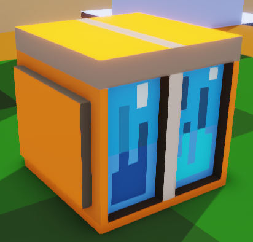
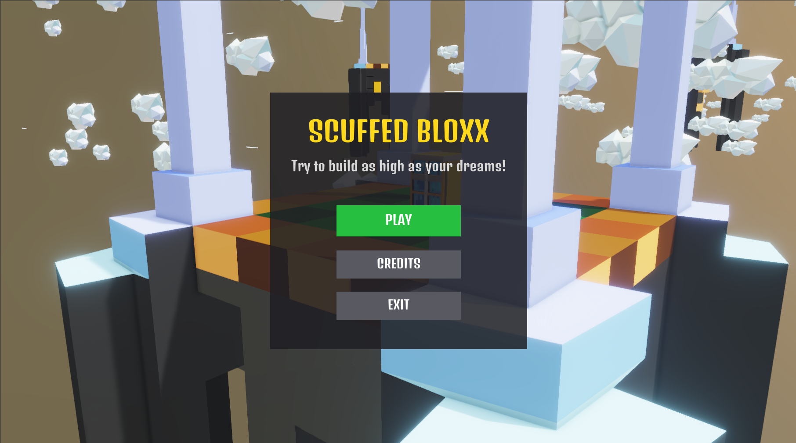
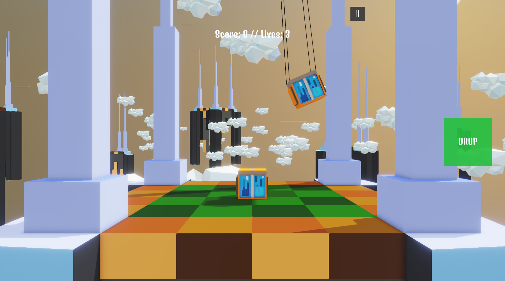

  <picture>
    
  </picture>

<h1 align="center">Scuffed Bloxx</h1>

  <b>A scuffed clone of the popular mobile game TowerBloxx made in a week via SurgeEngine</b> 

## Why?
Just because I wanted to test the capabilites of Surge, I made this game as a fun and simple project. You can download the game for Windows and Android(as .apk) on <a href="https://ridhwandll.itch.io/scuffedbloxx">itch.io</a>. Be warned though, this is not a very good of a game. Every aspect of the game is **imaginary** and **DO NOT REPRESENT ANY REAL LIFE INCIDENT**.

## Building

### Step 1
Setup and build <a href="https://github.com/ridhwandll/Surge_Expired#building">Surge Engine</a> in your PC. Full detailed instrctions on how to setup the engine(very simple) is given <a href="https://github.com/ridhwandll/Surge_Expired#building">here</a>.

### Step 2
Clone this repository, build Surge Engine and run Surge Editor(Project Browser will show up). Press `Open...` and select the `ScuffedBloxx.surgeproj` file located in the root of this repository.

### Step 3
Hit F5 in the editor and DONE!

## Screenshots

